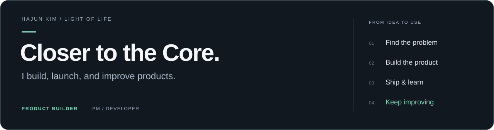
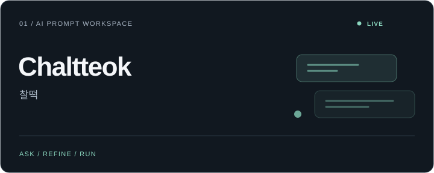
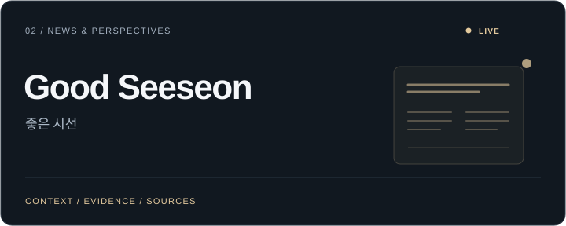
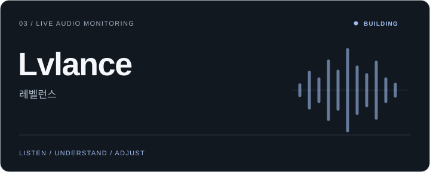
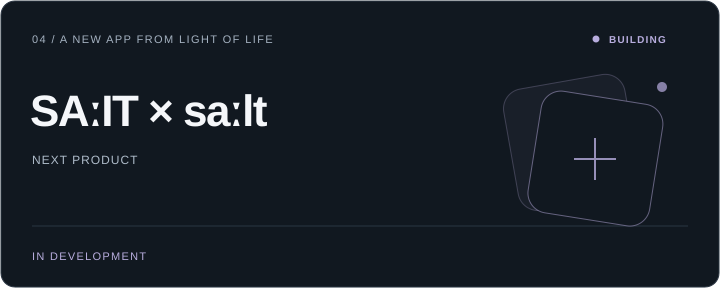

<a href="./README.md">English</a> · <strong>한국어</strong>

**Product Builder · LIGHT OF LIFE 운영**

문제를 찾고, 실제로 쓰이는 제품을 만들어 출시합니다.

[제품 보기](https://lightoflife.work/projects) · [LIGHT OF LIFE](https://lightoflife.work/) · [LinkedIn](https://www.linkedin.com/in/hajunkim) · [Email](mailto:kimjun9760@naver.com)

 

**LIGHT OF LIFE를 운영하는 김하준**입니다. 기획과 개발, AI와 운영을 연결해 아이디어를 실제로 사용할 수 있는 서비스로 만듭니다.

이 계정과 [LIGHTOFLIFE-Lab](https://github.com/LIGHTOFLIFE-Lab)에서 직접 만든 제품과 도구를 관리합니다. 소스 코드를 비공개로 운영하는 제품도 있습니다.

---

## 대표 프로젝트 · Selected Products

출시해 운영하는 서비스와, 그다음으로 만들고 있는 제품입니다.

<table>
<tr>
<td width="50%" valign="top">

### 찰떡 · Chaltteok

**운영 중 · AI 서비스**

평소 말하듯 요청하면 빠진 조건을 먼저 묻고, 바로 쓸 수 있는 프롬프트로 만들어 줍니다. 만든 자리에서 실행하고, 결과가 아쉬우면 이유를 골라 개선할 수 있습니다.

제품 기획과 구현부터 출시·운영·개선까지 직접 이어가는 AI 서비스입니다.

[**찰떡 사용하기 →**](https://chaltteok.cc/)

</td>
<td width="50%" valign="top">

### 좋은 시선

**운영 중 · 뉴스 웹앱**

뉴스의 사건과 배경을 쉽게 풀고, 서로 다른 관점의 이유와 근거를 함께 전합니다. 구체적인 질문과 풀이, 원문 출처를 연결해 스스로 이해하고 판단할 수 있도록 돕습니다.

뉴스를 읽고 생각하는 경험을 더 쉽게 만들기 위해 직접 제작하고 출시한 서비스입니다.

[**좋은 시선 읽어보기 →**](https://goodseeseon.link/)

</td>
</tr>
<tr>
<td width="50%" valign="top">

### 레벨런스 · Lvlance

**개발 중 · 라이브 음향 모니터링**

소규모 예배·공연 현장에서 무엇이 이상한지, 다음으로 무엇을 확인해야 하는지 판단할 수 있도록 돕습니다. 브라우저 구현인 LoLvlance는 마이크 입력을 지속적으로 분석해 음향 이슈와 첫 단계 EQ 가이드를 제공합니다.

현장의 필요를 바탕으로 제품 기획, 브라우저 오디오 모니터링, ML 연동을 연결합니다.

[**LoLvlance 살펴보기 →**](https://github.com/LIGHTOFLIFE-Lab/LoLvlance)

</td>
<td width="50%" valign="top">

### 개발 중인 다음 제품 · SAːIT × saːlt

**개발 중 · 앱**

LIGHT OF LIFE의 다음 앱 제품을 개발하고 있습니다. 제품의 상세 내용은 공개를 준비하고 있습니다.

[**프로젝트 소식 보기 →**](https://lightoflife.work/projects#salt)

</td>
</tr>
</table>

[LIGHT OF LIFE 제품 페이지 보기 →](https://lightoflife.work/projects)

---

## 도구와 실험 · Tools & Experiments

업무와 리서치, 일상의 필요에서 출발해 직접 만든 소프트웨어입니다. 공개 저장소와 내부 도구, 프로토타입을 함께 소개합니다.

| 프로젝트 | 만든 것 | 코드 |
|:---|:---|:---|
| **[DevLink-MCP](https://github.com/LIGHTOFLIFE-Lab/DevLink-MCP)** | 로컬 서버 설정, MCP 연결, 파일 동기화·배포·롤백 도구 | 공개 |
| **[Markup TXT Studio](https://github.com/LIGHTOFLIFE-Lab/Markup-TXT-Studio)** | `ai.txt`·`llms.txt` 생성과 구조화 데이터 마크업 검색 워크스페이스 | 공개 |
| **[GEO Tools](https://github.com/LIGHTOFLIFE-Lab/GEO-TESTER)** · [GEO-DEMO](https://github.com/LIGHTOFLIFE-Lab/GEO-DEMO) | AI 검색을 위한 웹사이트 진단·탐색 실험 | 공개 |
| **[SeeWe](https://github.com/Kimajun0919/SeeWe)** | 서울시 공개 데이터로 혼잡도 추정과 교통 정보를 보여주는 지도 기반 MVP | 공개 |
| **[Yield Balance](https://github.com/Kimajun0919/Money-Balance)** | 개인 자산 관리와 리밸런싱을 위한 프로토타입 | 공개 |
| **[하늘의 걸음](https://github.com/LIGHTOFLIFE-Lab/Bibleverses-Card-Template)** | 성경 구절 추천과 공유할 수 있는 말씀 카드 이미지 | 공개 |
| **HK Maintenance AI** | 유지보수 요청 처리, 유사 사례 검색, 사람의 검토를 연결하는 RAG·에이전트 워크플로 | 비공개 |
| **LawTrace** | 근거 추적과 출처 검증을 갖춘 법률 리서치·사건 분석 시스템 | 비공개 |
| **WorshipFlow** | 예배 현장을 위한 음원 분리와 라이브 반주 제어 | 비공개 |
| **Worshipbook** | 찬양 인도자와 팀원을 위한 콘티 구성·악보 화면 동기화 | 비공개 |
| **We-Are-Artists** | 신진 아티스트를 위한 쇼케이스·아카이브 플랫폼 기획, 사업 설계, 프론트엔드 데모 | 비공개 |

---

## 기술과 배경 · Stack & Background

| 영역 | 주로 하는 일과 사용하는 기술 |
|:---|:---|
| **제품 기획** | 문제 발견, PRD, IA, 사용자 흐름, 우선순위, 프로젝트 관리 |
| **웹·백엔드** | TypeScript, JavaScript, React, Next.js, Node.js, Python |
| **AI·자동화** | LLM 연동, RAG, MCP, 에이전트 워크플로, API 연동 |
| **설계·운영** | Figma, Notion, Git / GitHub, QA, 배포, 프로세스 개선 |

**경영학·지능형소프트웨어·Apple Developer Academy**를 배경으로 웹·앱 개발과 프로덕트·프로젝트 관리를 경험했습니다.

문제의 맥락을 이해하고, 만들 수 있는 범위를 정의하고, 직접 구현해 사용 과정에서 개선합니다.

---

## 연락처 · Contact

함께 풀고 싶은 문제가 있다면 편하게 연락해 주세요.

[Email](mailto:kimjun9760@naver.com) · [LinkedIn](https://www.linkedin.com/in/hajunkim) · [LIGHT OF LIFE](https://lightoflife.work/) · [LIGHTOFLIFE-Lab](https://github.com/LIGHTOFLIFE-Lab)

 

**Closer to the Core.**

문제를 찾고 · 제품을 만들고 · 출시하고 · 계속 개선합니다

